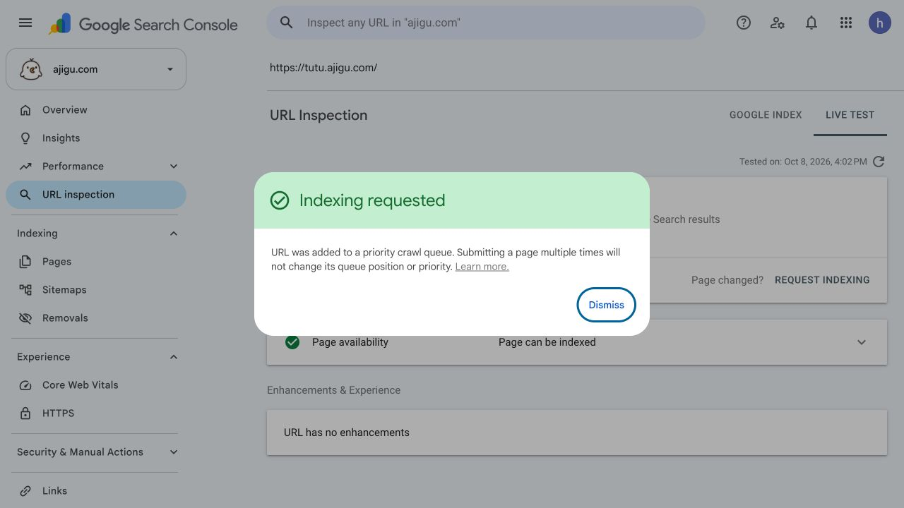
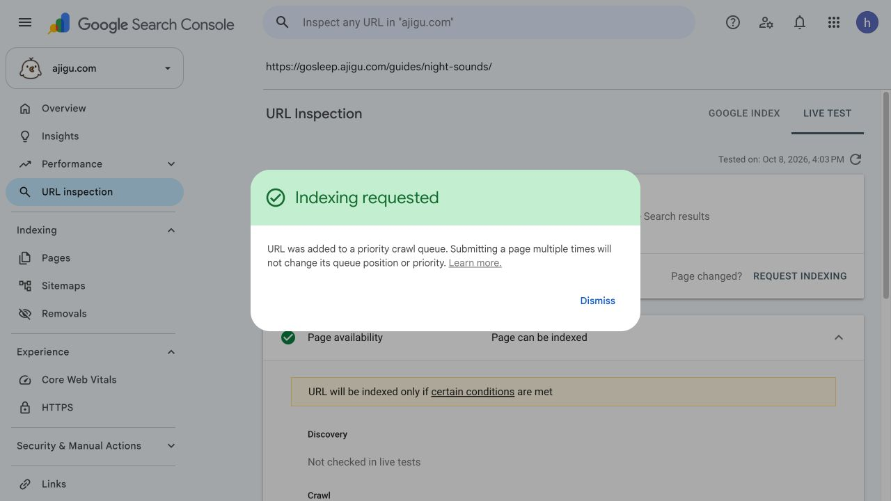
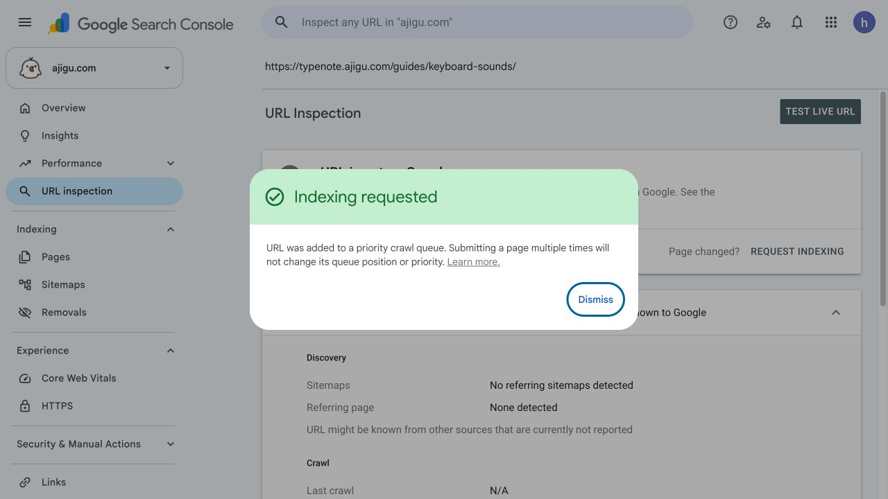
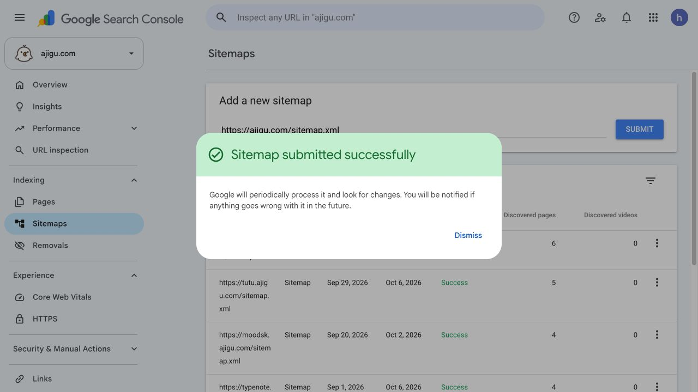

# Search Console Indexing Review

Checked on 2026-10-08 (Asia/Shanghai) in the authenticated Search Console UI for `sc-domain:ajigu.com`. Public HTTP responses were checked separately. The property includes the root domain and product subdomains.

## Conclusion

The canonical notification is expected URL consolidation. All three affected parameter URLs have a Google-selected canonical that matches the site declaration. Both canonical destinations are indexed.

The useful follow-up is the set of 39 content URLs that are not indexed. The report alone does not establish a content-quality, server-capacity, or crawl-priority cause.

## Report Snapshot

The Page indexing report shows a last update of 2026-10-04. It lists 19 indexed URLs and 45 excluded URLs. This is a report snapshot, not an immediate count of every current site page.

| State | URLs | Assessment |
|---|---:|---|
| Alternate page with proper canonical tag | 3 | Expected parameter URL consolidation |
| Page with redirect | 3 | Expected HTTPS and trailing-slash redirects |
| Discovered - currently not indexed | 38 | Google knows the URLs; no crawl date is reported |
| Crawled - currently not indexed | 1 | Go Sleep night-sounds guide; last crawl is old |

## Canonical Exclusions

| Excluded URL | Site and Google canonical | Last crawl |
|---|---|---|
| `https://ajigu.com/nameplate/?lang=ja` | `https://ajigu.com/nameplate/` | 2026-09-30 |
| `https://ajigu.com/nameplate/?lang=zh-hant` | `https://ajigu.com/nameplate/` | 2026-09-29 |
| `https://typenote.ajigu.com/?lang=en` | `https://typenote.ajigu.com/` | 2026-09-29 |

URL Inspection reports successful fetches, allowed crawling, and allowed indexing for all three. Separate inspection confirms that the Nameplate and TypeNote canonical destinations are on Google.

Current public responses are HTTP 200 with the same canonical declarations. Nameplate currently has English and Simplified Chinese routes. Its legacy Japanese parameter maps to English; its legacy Traditional Chinese parameter maps to Simplified Chinese through client navigation. The exclusion records predate the October 2 locale-route changes. They do not prove that Google has processed those changes.

## Redirect Exclusions

Live checks confirm HTTP 301 followed by HTTP 200:

- `http://ajigu.com/` -> `https://ajigu.com/`
- `https://ajigu.com/zh-hant` -> `https://ajigu.com/zh-hant/`
- `https://ajigu.com/ko` -> `https://ajigu.com/ko/`

## Discovered URLs

| Product | URLs | Composition |
|---|---:|---|
| Go Sleep | 25 | Seven locale homepages, sixteen privacy/support pages, and two translated guides |
| Daily APOD | 5 | Three locale homepages and two translated guides |
| TUTU | 5 | The root homepage and four locale homepages |
| TypeNote | 3 | The English keyboard-sounds guide and two translations |

The Go Sleep locales are `de`, `en-gb`, `fr`, `ja`, `ko`, `zh-hans`, and `zh-hant`. Each has a homepage, privacy page, and support page in this set. The set also includes root `/privacy/`, root `/support/`, and `/guides/night-sounds/ja/` and `/guides/night-sounds/zh-hans/`.

The Daily APOD URLs are `/ja/`, `/ko/`, `/zh-hant/`, `/guides/what-is-apod/ja/`, and `/guides/what-is-apod/zh-hans/`.

The TUTU URLs are `/`, `/ja/`, `/ko/`, `/zh-hans/`, and `/zh-hant/`.

The TypeNote URLs are `/guides/keyboard-sounds/`, `/guides/keyboard-sounds/ja/`, and `/guides/keyboard-sounds/zh-hans/`.

Separate TUTU root URL Inspection confirms `Discovered - currently not indexed`, no last crawl, and discovery through the submitted sitemap. Public checks of the TUTU homepage and TypeNote English guide return HTTP 200, self-referencing canonicals, and no robots meta or X-Robots-Tag directive. These checks do not substitute for Google live URL tests or prove fetchability of every translated URL.

## Crawled Guide

`https://gosleep.ajigu.com/guides/night-sounds/` is the only crawled-but-not-indexed URL. URL Inspection reports:

- Last crawl: 2026-09-07.
- Successful fetch; crawling and indexing allowed.
- User-declared canonical: none in the old crawl record.
- Google-selected canonical: the inspected URL.
- Sitemap field: temporary processing error.

The current public page returns HTTP 200 and declares the correct self-referencing canonical, with no robots meta or X-Robots-Tag directive. The old crawl record does not reflect this current declaration. The sitemap overview separately reports Success for Go Sleep, so the per-URL processing error is not evidence of a current site-wide sitemap failure.

## Submitted Sitemaps

All six submitted sitemaps report Success.

| Site | Discovered pages | Last read |
|---|---:|---|
| ajigu.com | 6 | 2026-09-30 |
| TypeNote | 4 | 2026-10-06 |
| Daily APOD | 8 | 2026-10-01 |
| Go Sleep | 27 | 2026-10-01 |
| Moodsk | 4 | 2026-10-02 |
| TUTU | 5 | 2026-10-06 |

The current root sitemap contains seven URLs, including the new Simplified Chinese Nameplate route. Its last recorded read predates that route change.

## Recommended Follow-up

1. Prioritize a Google live URL test and an indexing request for the TUTU root homepage.
2. Test the current Go Sleep night-sounds guide and request a new crawl of its corrected canonical version.
3. Prioritize the English TypeNote guide, then useful localized product entry pages. Confirm content and internal-link value before trying to index every privacy/support URL.
4. Keep the valid parameter canonical and redirect behavior. There is no canonical defect to validate for the notification.

No indexing requests, validation requests, sitemap resubmissions, site changes, or deployments were made during the initial review. The authorized follow-up below records later actions. Findings and recommendations do not guarantee indexing.

Source: [Search Console property](https://search.google.com/search-console/index?resource_id=sc-domain:ajigu.com).

## Authorized Follow-up: 2026-10-08

The user requested remediation after the initial review. All actions below were completed in the authenticated Search Console UI.

| URL | Verification | Action and confirmed result |
|---|---|---|
| `https://tutu.ajigu.com/` | Google live test: available to Google; page can be indexed | Indexing requested; added to the priority crawl queue |
| `https://gosleep.ajigu.com/guides/night-sounds/` | Google live test: successful fetch; crawling and indexing allowed; correct self-referencing canonical | Indexing requested; added to the priority crawl queue |
| `https://typenote.ajigu.com/guides/keyboard-sounds/` | Fresh URL Inspection reported unknown to Google, unlike the older aggregate discovery report; request flow tested indexability | Indexing requested; added to the priority crawl queue |
| `https://ajigu.com/nameplate/zh-hans/` | Fresh URL Inspection: URL is on Google; page is indexed | No duplicate request needed |
| `https://ajigu.com/sitemap.xml` | Public sitemap contains seven correct URLs | Resubmitted successfully; submission date changed to October 8 |

After resubmission, the sitemap table still showed its previous September 30 last-read date and six discovered pages. The new submission is accepted; processing of the current seven-URL sitemap is not yet confirmed. All six sitemap rows still report Success.

No site source changes or deployments were required. The valid canonical exclusions remain expected. Requests do not confirm that Google has indexed the three requested URLs, and the remaining locale URLs have not been individually submitted.

### Submission Evidence

TUTU:

Go Sleep:

TypeNote:

Root sitemap:

